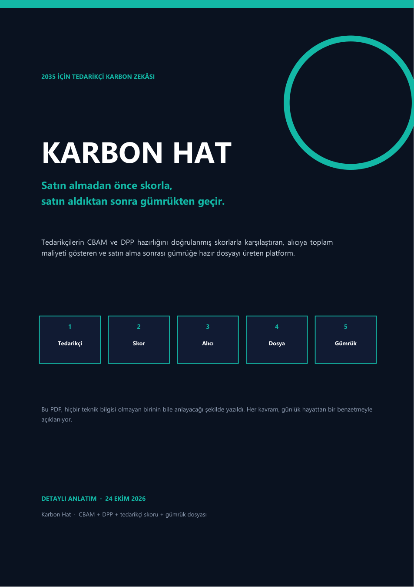

# Karbon Hat

> **Satın almadan önce skorla, satın aldıktan sonra gümrükten geçir.**

Karbon Hat, AB alıcısının tedarikçiyi **satın almadan önce** doğrulanmış karbon ve uyum skoruyla seçmesini sağlayan; satın aldıktan sonra **gümrüğe hazır CBAM + DPP dosyasını** üreten açık kaynak bir hackathon prototipidir.



> **Durum:** Hackathon prototipi / araştırma projesi. Üretim yazılımı değildir; hukuki/mali görüş değildir. Tüm demo verileri simülasyondur.

---

## Neden?

- AB'ye mal satan üretici, **CBAM** (karbon sınır vergisi) ve **DPP** (Dijital Ürün Pasaportu) verisini hazırlamak zorunda.
- Veri Excel, ERP, WhatsApp ve e-postada dağınık; danışman süreci haftalar sürüyor.
- Alıcı, tedarikçinin gerçekten hazır olup olmadığını **satın almadan önce** bilmiyor.
- Yanlış tedarikçi = gümrükte gecikme, ceza, fazla karbon vergisi, itibar riski.
- Tedarikçi iyi olsa bile bunu kanıtlayamıyor; sipariş kaybediyor.

## Nasıl çalışır?

| Katman | Ne yapar? |
|---|---|
| **Score** | Tedarikçiye 0–100 karne: doğrulanmış karbon verisi, veri kalitesi, DPP hazırlığı, teslim, sertifika. Skor satın alınamaz. |
| **Match** | Alıcı RFQ açar; doğrulanmış tedarikçileri skor + karbon + **toplam maliyet** ile karşılaştırır. |
| **File** | Seçimden sonra CBAM + DPP dosyası, bağımsız doğrulayıcı imzası ve gümrük QR'ı üretilir. |

**Toplam maliyet** = fiyat + CBAM sertifika maliyeti + lojistik + risk. En ucuz teklif, karbonla en pahalı çıkabilir.

## Demo

- **Canlı demo:** https://bsyilmaz.github.io/karbon-hat/
- **Yerel:** `demo/index.html` dosyasını tarayıcıda aç. Kurulum yok.
- Akış: **Tedarikçi bul → toplam maliyet → seç → dosya/QR → teslim/skor güncellemesi.**

Demo tamamen istemci tarafındadır; gerçek API/veri yoktur. Tüm veriler simülasyondur.

## Mentor paketi

- `mentor/Mentor-Sunum-5-Slayt.pdf` — 5 slaytlık mentor sunumu
- `mentor/Mentor-Prompter.pdf` — 3 dakikalık büyük puntolu prompter
- `mentor/Mentor-Soru-Cevap.md` — muhtemel sorular + mentor'a sorulacaklar

## Repo yapısı

```
.
├─ demo/
│  └─ index.html                 # 90 saniyelik tıklanabilir demo
├─ docs/
│  ├─ Karbon-Hat-Detayli-Anlatim.pdf
│  ├─ 00-OKU-BENI.md
│  ├─ 01-Urun-Ozeti.md
│  ├─ 02-Pitch-ve-Slaytlar.md
│  ├─ 03-Demo-Senaryosu.md
│  ├─ 04-Juri-Sorulari.md
│  ├─ 05-48-Saat-Plani.md
│  ├─ 06-Dogrulama-ve-Scorecard.md
│  ├─ 07-Fiyatlandirma.md
│  ├─ 08-Riskler.md
│  ├─ 09-Teslim-Checklist.md
│  ├─ 10-Kaynaklar.md
│  ├─ 11-Basvuru-Ozeti.md
│  └─ 12-Gorusme-Notu-Sablonu.md
├─ assets/
│  └─ cover.png
├─ CONTRIBUTING.md
├─ LICENSE
└─ README.md
```

## Hızlı başlangıç

1. `demo/index.html` dosyasını tarayıcıda aç.
2. `docs/00-OKU-BENI.md` ile paketi oku.
3. `docs/02-Pitch-ve-Slaytlar.md` ile 10 slaytı çıkar.
4. `docs/04-Juri-Sorulari.md` ile Q&A provası yap.
5. `docs/06-Dogrulama-ve-Scorecard.md` ile görüşme sorularını kullan.

## Neden şimdi?

- CBAM kesin rejimi: **1 Ocak 2026**.
- İlk yıllık CBAM beyanı: **30 Eylül 2027**.
- AB DPP Registry: **20 Temmuz 2026**.
- Batarya pasaportu: **18 Şubat 2027**.

## İş modeli (varsayım)

| Gelir | Kim öder? | Fiyat `[A]` |
|---|---|---|
| Tedarikçi SaaS | İhracatçı | €250–500/ay |
| Alıcı SaaS | AB alıcısı/marka | €500–2.000/ay |
| Doğrulama | Tedarikçi | €3.000/yıl |
| Eşleştirme/işlem | Alıcı/tedarikçi | %0,5–2 |

50 tedarikçi + 10 alıcı = **€320k ARR** `[A]`; 1.000 + 100 = **€5,2M** `[A]`.

## Yol haritası

- **0–3 ay:** 10 alıcı/tedarikçi görüşmesi, 3 pilot, 1 doğrulayıcı LOI.
- **3–12 ay:** 50 tedarikçi, 10 alıcı, ilk €100k ARR.
- **12–24 ay:** 200 tedarikçi, 20 alıcı; AB pazarı.
- **24–36 ay:** Marketplace + karbon raporu; €1M+ ARR.
- **2035:** Her B2B satın alma karbon + DPP skoruyla başlar.

## Katkı

Katkı rehberi: [`CONTRIBUTING.md`](CONTRIBUTING.md). Özellikle şu alanlarda yardım lazım:

- Scorecard modeli ve ağırlıklar
- Demo UI/UX
- CBAM/DPP mevzuat araştırması
- Alıcı/tedarikçi görüşmeleri
- İngilizce çeviri
- Test ve erişilebilirlik

## Lisans

MIT — ayrıntılar [`LICENSE`](LICENSE). Docs ve demo aynı lisans altında; atıf beklenir.

## Feragatname

- Bu repo bir **hackathon prototipi**dir; üretim/hukuki/mali tavsiye değildir.
- Tüm pazar, fiyat ve skor sayıları `[A]` varsayımdır.
- Demo verileri `[S]` simülasyondur; gerçek müşteri/LOI/ortaklık yoktur.
- EcoVadis, SAP, Coupa gibi isimler yalnızca rakip bağlamında geçer; ortaklık ima etmez.
